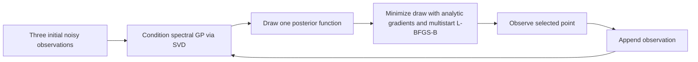
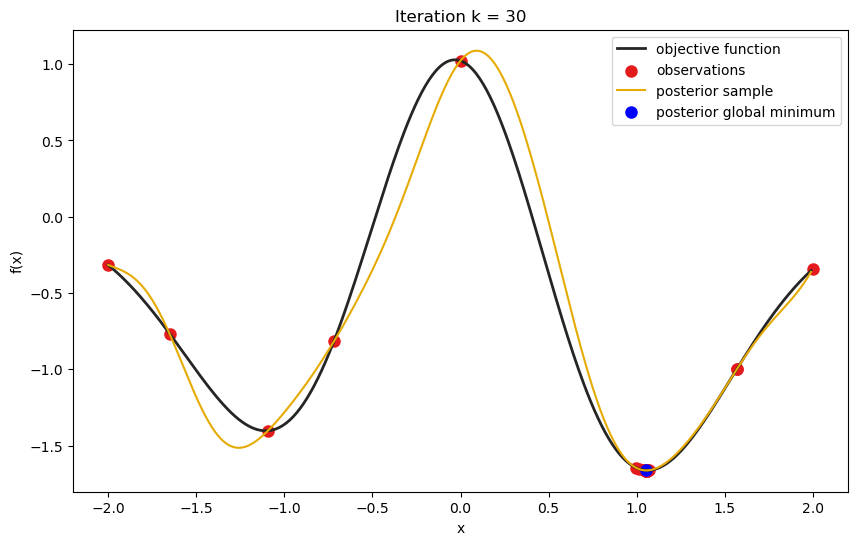

# Gaussian-Process Bayesian Optimization

A reproducible graduate course implementation of one-dimensional Bayesian optimization using a spectral Gaussian-process surrogate, posterior function sampling, and Thompson sampling.

## Problem / objective

Sequentially select evaluations of a noisy synthetic objective on **[-2, 2]** to seek low function values. The objective is a fixed combination of spectral basis functions 1 and 2 with coefficients **[-0.25, -2.5]**. Observations add independent Gaussian noise with standard deviation **0.001**.

This project makes the probabilistic modeling and numerical optimization steps explicit, from a finite GP expansion to each new evaluation decision. It implements standard methods as a course exercise; it does not propose a new GP model or optimization algorithm.

## Method overview

1. **Gaussian-process surrogate:** a zero-mean squared-exponential GP approximated by a **50-term truncated Wiener series**, with recursively evaluated eigenfunctions and geometric eigenvalues. The expansion uses Gaussian reference-measure scale **1.0** and kernel length scale **0.4**; these parameters remain fixed.
2. **Posterior sampling:** form the spectral design matrix, compute its reduced singular value decomposition, and condition the Gaussian coefficient distribution on the observations. Draw coefficients using the notebook's low-rank square-root correction.
3. **Thompson sampling:** use one sampled posterior function as the acquisition objective and keep that draw fixed throughout the acquisition search.
4. **Derivative-based search:** minimize the acquisition with analytic derivatives and bounded **L-BFGS-B**, starting at **[-2, -1, 0, 1, 2]** and retaining the best candidate found. This local search does not certify a global minimum.
5. **Sequential optimization:** begin with observations at **[-2, 0, 2]**, choose and observe one candidate at a time, then recompute the posterior. The default experiment performs **30 additional iterations**, giving **33 observations** in total.



The posterior-update cycle stops after the requested number of additional evaluations.

## Representative result



This image is extracted unchanged from **iteration 30 of the original notebook**, not from the new seeded demonstration. It shows observations available before that iteration's update, one posterior draw, and the selected point on that draw. Its legacy label “posterior global minimum” describes the selected candidate; the search provides no global-optimality certificate. The original 30-page iteration PDF is preserved in [provenance/](provenance/K_Iterations.pdf).

The figure illustrates one historical run. No benchmark comparison, speedup, convergence rate, or performance guarantee is claimed.

## Repository structure

```text
.
├── README.md
├── requirements.txt
├── .gitignore
├── .gitattributes
├── notebooks/
│   ├── original_project.ipynb       # unchanged notebook, including original outputs
│   └── cleaned_demo.ipynb           # concise demo; committed without outputs
├── src/
│   ├── __init__.py
│   ├── gp_model.py                 # spectral basis, eigenvalues, derivatives
│   ├── posterior_sampling.py       # SVD conditioning and coefficient draws
│   ├── acquisition.py              # fixed posterior draw and gradient
│   ├── optimization.py             # synthetic objective, BO loop, runnable CLI
│   └── utils.py                    # validation and local random generator
├── tests/
│   ├── __init__.py
│   ├── test_gp.py
│   ├── test_sampling.py
│   ├── test_shapes.py
│   └── test_optimization.py
├── scripts/
│   └── run_notebook.py              # headless demo execution without Jupyter
├── figures/
│   └── representative_result.png
├── provenance/
│   ├── K_Iterations.pdf
│   └── manifest.json               # original archive and artifact SHA-256 hashes
└── docs/
    ├── implementation_notes.md
    └── portfolio.md                # publication commands and application copy
```

## Reproduction

Use **Python 3.11 or newer**. The pinned dependencies were validated with **Python 3.13.5**; this is the locally tested interpreter, rather than a claim of testing every supported Python version. No external dataset or API is needed.

```bash
git clone https://github.com/nafeezatajenifuja/gaussian-process-bayesian-optimization.git
cd gaussian-process-bayesian-optimization
python -m venv .venv
```

Activate the environment in PowerShell:

```powershell
.\.venv\Scripts\Activate.ps1
```

Or on macOS / Linux:

```bash
source .venv/bin/activate
```

Install and validate from the repository root:

```bash
python -m pip install -r requirements.txt
python -m unittest discover -s tests -v
python -m src.optimization --seed 100 --iterations 30
python scripts/run_notebook.py
```

The optimization command writes `figures/seeded_demo.png` and `results/seeded_history.npz`. The history contains observation locations and values, posterior coefficient draws, acquisition values, local-solver success counts, and run settings. These generated files are ignored by Git. The preserved representative figure is never overwritten by these commands.

`notebooks/cleaned_demo.ipynb` can also be opened in an existing Jupyter-compatible editor. The headless runner executes the same plain-Python cells without installing notebook tooling or writing cell outputs into the source notebook. The demo finds the repository root when opened from either the root or the `notebooks/` directory.

Seed **100** is introduced for the reorganized demonstration; the original optimization notebook has **no fixed seed**. Fixed-seed behavior is tested within the same numerical environment. Exact floating-point trajectories can differ across numerical-library versions and platforms. The preserved notebook is a historical artifact; use the cleaned demo to run with the pinned current dependencies, because the original scalar-assignment syntax is incompatible with current NumPy.

## Technology stack

**Python, NumPy, SciPy, and Matplotlib.** Seaborn is also listed in `requirements.txt` because it is imported in the original notebook, although the extracted implementation does not use it. `pylab` in the original notebook is part of Matplotlib. Tests use Python's standard-library `unittest`; notebook execution uses standard-library JSON handling. There is no additional Bayesian-optimization framework dependency.

## Technical highlights

- Explicit finite-feature GP construction and Gaussian conditioning rather than a framework wrapper.
- Posterior function draws retain the coefficient covariance through an SVD-based transformation.
- Analytic derivatives of the eigenfunction recurrence support gradient-based acquisition minimization.
- A single random generator controls new observation noise and posterior draws without changing global NumPy random state.
- Lightweight checks cover array dimensions, fixed-seed repeatability, posterior sample moments, covariance sanity, finite-difference gradients, and acquisition-search behavior.
- The original notebook, outputs, and iteration PDF remain available for provenance, with artifact hashes recorded separately.

## Limitations

This is a **graduate course implementation**, not a production Bayesian-optimization framework. It addresses a single one-dimensional synthetic objective with a fixed domain, fixed spectral truncation, fixed GP parameters, and a known observation-noise scale. There is no hyperparameter learning, baseline evaluation, regret study, constraint handling, batch acquisition, or multidimensional experiment. Repeated evaluations at similar locations are permitted.

Multistart L-BFGS-B is a local numerical method. Solver success counts are exposed for inspection, but no global optimum or convergence guarantee is established. The original unseeded trajectory cannot be regenerated exactly from a documented seed. The cleaned implementation corrects an initial-candidate indexing error and modernizes a scalar assignment; these changes are documented in [implementation notes](docs/implementation_notes.md). They preserve the intended method, while a new seeded run may choose a different evaluation sequence from the historical run.

## Provenance

Originally developed as a graduate Decision-Making with Uncertainty course project at the University of Houston and subsequently reorganized for reproducibility and portfolio presentation.

The source is `Nafeezat_CIVE_7397_Project (1).zip`, specifically `Nafeezat_CIVE_7397_Project/Nafeezat_Project.ipynb`. The two accessible course-project ZIP copies have identical SHA-256 hashes; their checkpoint and main notebook have identical cell source code but different saved outputs. The original main notebook was copied byte for byte to `notebooks/original_project.ipynb`.

See the [implementation notes and claim-verification checklist](docs/implementation_notes.md) for the mapping from original cells to modules, documented corrections, and the limits of the inspection. The course title and institutional attribution above were supplied by the author and should be confirmed before publication. No license has been selected or added.
